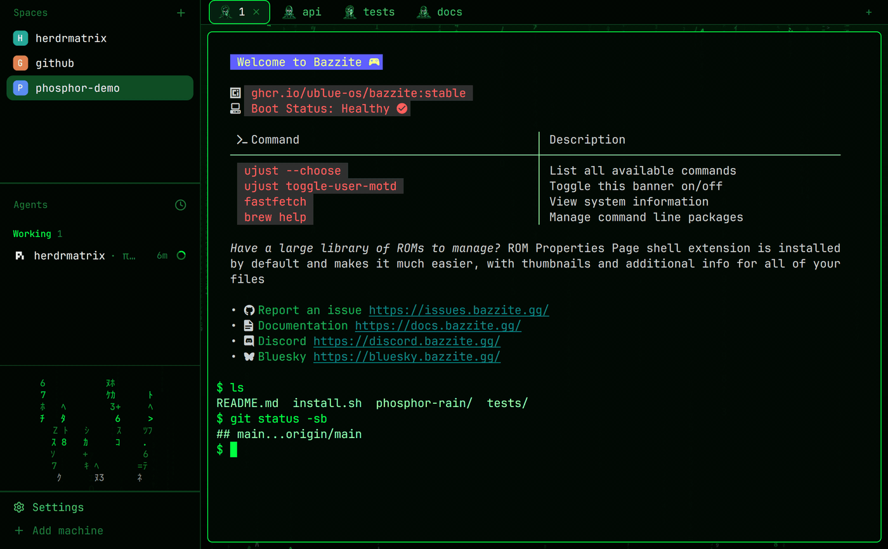

# Phosphor Rain for Herdr

A green-phosphor neon layout for [Herdr](https://herdr.dev) with digital rain, position-based tab avatars and a rain wallpaper.



## Requirements

- Herdr Desktop. Tested with 0.1.15 on Linux x86-64. macOS should work but is not verified. Start Herdr at least once so `~/.config/herdr-app` exists.
- `curl` or `wget`, and `tar`.
- Windows is not supported by the installer.

## Install

```sh
curl -fsSL https://raw.githubusercontent.com/gara501/herdrmatrix/main/install.sh | sh
```

Prefer to read it first?

```sh
curl -fsSL https://raw.githubusercontent.com/gara501/herdrmatrix/main/install.sh -o install.sh
less install.sh
sh install.sh
```

The installer copies the layout, theme and mods into `~/.config/herdr-app`. It never overwrites existing files without `--force`, and it never touches `programs.json`.

**Activate:** press `ctrl-shift-l` and choose `phosphor-rain`, or let the installer switch for you. `--apply` works on a fresh install and on one you already have:

```sh
curl -fsSL https://raw.githubusercontent.com/gara501/herdrmatrix/main/install.sh | sh -s -- --apply
```

To update the files to this version and switch:

```sh
curl -fsSL https://raw.githubusercontent.com/gara501/herdrmatrix/main/install.sh | sh -s -- --force --apply
```

## Options

**When you pipe from curl, put flags after `sh -s --`, for example `... | sh -s -- --force`. Writing `| sh --force` does not work.**

Flags:

| Flag | What it does |
| --- | --- |
| `--force` | Replace files you already have with this version. |
| `--apply` | Switch to the `phosphor-rain` layout. Installs first if needed, and never needs `--force`. Needs `herdr-app`. |
| `--uninstall` | Remove the Phosphor Rain payload. Nothing else is touched. |
| `--help`, `-h` | Show usage and exit. |

Flags combine: `--force --apply` replaces the files and then switches the layout. Without `--force`, existing files are never overwritten.

Environment variables:

| Variable | Default | What it does |
| --- | --- | --- |
| `HERDR_APP_HOME` | `$HOME/.config/herdr-app` | Herdr home to install into. |
| `HM_REF` | `main` | Tag or commit to download. Use it to pin a version. |
| `HM_REPO` | `gara501/herdrmatrix` | GitHub repo to download from. |
| `HM_SRC` | unset | Local directory to copy from instead of downloading. It must contain `phosphor-rain/`. |
| `HM_TARBALL_URL` | unset | Full tarball URL. Overrides `HM_REPO` and `HM_REF`. |

## Layout options

The layout is plain JSON, so its "knobs" are node properties in `~/.config/herdr-app/layouts/phosphor-rain.json`:

| Option | How |
| --- | --- |
| Hide the Settings / Add machine footer | Add `"hidden": true` to the `sidebar-footer` node, or run `herdr-app do layout.toggle '{"id":"sidebar-footer"}'` |
| Make the rain block taller or shorter | Drag its top divider, or `herdr-app do layout.resize '{"id":"rain","px":150}'` |
| Hide the rain block | `herdr-app do layout.toggle '{"id":"rain"}'` |

Re-running the installer with `--force` replaces the layout file, so keep local edits in a copy.

## What gets installed

Into `~/.config/herdr-app`:

- `layouts/phosphor-rain.json` and `layouts/phosphor-rain.svg`
- `themes/phosphor-rain.json`
- `mods/phosphor-rain/`
- `mods/phosphor-tabs/`

Optional: merge `phosphor-rain/programs.json` into your own `programs.json` by hand for agent icons. The installer does not change it.

## Update / Remove

- **Update:**

  ```sh
  curl -fsSL https://raw.githubusercontent.com/gara501/herdrmatrix/main/install.sh | sh -s -- --force
  ```

- **Remove:**

  ```sh
  curl -fsSL https://raw.githubusercontent.com/gara501/herdrmatrix/main/install.sh | sh -s -- --uninstall
  ```

- **Switch back:** press `ctrl-shift-l` and choose another layout.

## Troubleshooting

- **`Herdr home not found`:** start Herdr Desktop once so `~/.config/herdr-app` exists, then retry.
- **`check failed for ...`:** the files stay installed. Run with `--uninstall` to remove them, or see [RECIPE.md](phosphor-rain/RECIPE.md) for what each mod needs.
- **Katakana show as boxes:** your system font lacks the glyphs. See "Watch out" in [RECIPE.md](phosphor-rain/RECIPE.md#watch-out).

## How it works

The layout runs native animation in the rain mod, with no timers, network or file access. Tab images follow their position, so a tab's avatar changes when you move it.

Details are in [`phosphor-rain/RECIPE.md`](phosphor-rain/RECIPE.md).

## Maintainers

`scripts/export-from-herdr.sh` copies your local Herdr copy into this repo and retakes `preview.png` (the still; `preview.gif` is the animated README image and is recorded by hand). To do that it switches the live Herdr layout to `phosphor-rain`. It does not stage files. Review with `git diff`, then commit what you want.

Tests: `sh tests/test_install.sh`

*Last reviewed: 2026-11-11*
