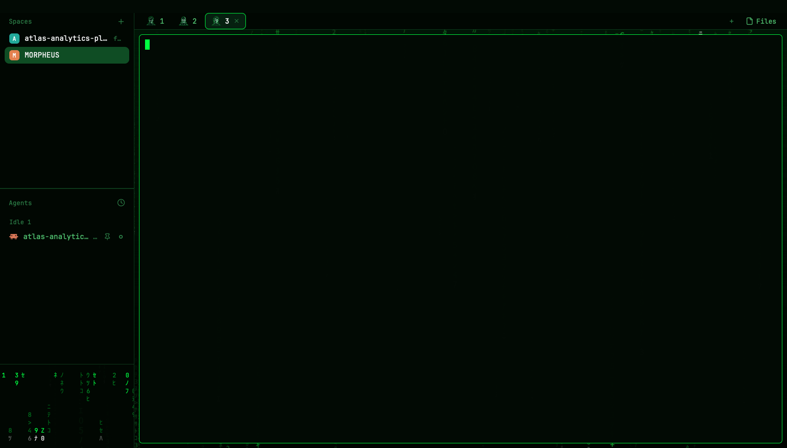

# Phosphor Rain

Herdr in green-phosphor neon on near-black. The sidebar (spaces, agents) has a column of animated digital rain at its bottom. Each tab shows an avatar picked by its position, and the background is a full-window digital-rain image that shows through translucent pane cards. When any agent is blocked, the rain turns neon red.

## What you see

- **Background:** `mods/phosphor-rain/backgrounds/phosphor-rain.jpg` (2560×1600, `cover`). It shows digital rain in three depths on a `#001a07` → `#000300` gradient, with scanlines and a vignette.
- **Sidebar (left, 240px, `#010702e0`):** shipped `spaces` on top, shipped `agents` below, and a 150px `rain` block at the bottom. The rain is 22 columns × 9 rows of 11px half-width katakana, digits and symbols, falling in streaks of 4 in `#00ff41`. The bottom row is `#9dffb4`.
- **Tabs (top, 30px, `#010702cc`):** the `phosphor-tabs` mod, a clone of the shipped `tabs`. Each tab shows an 18px image by position: `mods/phosphor-rain/tabs/tab-1.png` … `tab-9.png`, repeating from tab 10. The active tab has a 1px `#00ff41` border. The Files and Changes buttons open the right panel.
- **Right panel (320px, hidden by default):** a `panel-body` stack with the shipped `files` and `changes` mods.
- **Panes:** 8px padding and gap, radius 6, background `#020a04b3`, 1px border `#0d3b1c`. The focused pane's border is `#00ff41`. A single pane is framed too (`lone: true`).
- **Terminal:** JetBrains Mono 14, padding `[10, 8]`, opacity 0.82, cursor `#00ff41`, selection `#0f4d24`. The UI font is also JetBrains Mono.
- **ANSI:** green `#00ff41`, cyan `#00ffd5`, lime-yellow `#d4ff3a`, red `#ff3b5c`, blue `#00b3ff`, violet `#b26bff` (full list in `themes/phosphor-rain.json`).
- **Program icons (optional):** five original neon avatars in `mods/phosphor-rain/icons/`, mapped through `programs.json`. They appear in the agents list and pane headers.

## How it behaves

- Agent colors: working `#00ff41`, done `#00ffd5`, blocked `#ff3b5c`, idle `#2a7a44`.
- Any agent `blocked` turns the rain glyphs `blocked` red until no agent is blocked.
- Each row is one element with .frames at 110 ms. Columns share a speed but start at different offsets, and each row pulses in opacity (0.45–1, with a 1.1–1.8 s period).
- Tab images follow position. Dragging a tab to a new spot gives it that spot's image.
- The rain block can be resized by dragging its top divider (0–400px) or hidden with `layout.toggle {id: "rain"}`.

## Built from

- `layouts/phosphor-rain.json`: root `row` → `sidebar` column (`spaces`, `agents`, `rain` → mod `phosphor-rain`) and `work` column (`tabs` → mod `phosphor-tabs`, then a `body` row with `main` → `{ "tab": "active" }` and `panel` → stack `panel-body` with `files` and `changes`). The root sets `theme`, `colors`, fonts, `terminal_padding`, `terminal_opacity`, the `background` image and `preview`.
- `themes/phosphor-rain.json`: copy it to the home's `themes/`. It is named like the layout, so Settings offers it only there.
- `mods/phosphor-rain/`: the rain view, which uses only `theme()` and `agents()`. The animation is native: `.frames(glyphs, ms)` per cell and `.loop("opacity", …)` per column. No timers, no `exec`, no network, no file access. The folder also holds `backgrounds/`, `icons/` and `tabs/`.
- `mods/phosphor-tabs/`: a clone of the shipped `tabs`. Its one change is `image(\`mods/phosphor-rain/tabs/tab-${(i % 9) + 1}.png\`).size(18)` in place of the program icon, plus the accent border on the active tab.
- `programs.json` (optional): merge its entries into the person's own `programs.json`. Do not overwrite the file.

## Watch out

- Every asset path is relative to `~/.config/herdr-app`, and the assets live inside the mod folders so they travel with them.
- Tab images must be pre-shrunk to 36×36 px (2× of 18px) with crisp edges and no outer glow. Large images downscaled at runtime look blurry.
- A missing `tab-N.png` leaves an empty slot. There is no fallback to the program icon.
- The cloned tabs mod expects nodes `panel` and `panel-body`. Without them, Files and Changes show `layout.show failed`.
- Half-width katakana (U+FF71–U+FF9D) are not in JetBrains Mono and rely on system font fallback. If they show as boxes, swap `GLYPHS` for ASCII.
- The rain has 9 animated elements, one per row. Per-cell animation (198 elements) made herdr-app check interrupt.

## Done when

- `herdr-app check` passes for `mods/phosphor-rain` and `mods/phosphor-tabs`.
- `herdr-app do layout.switch '{"name":"phosphor-rain"}'` shows the green theme, and `layout.error` does not exist.
- Tabs 1–9 each show their image, and tab 10 shows `tab-1`.
- Files and Changes open and close the right panel without error toasts.
- An agent going `blocked` turns the rain red, and answering it turns the rain green again.
